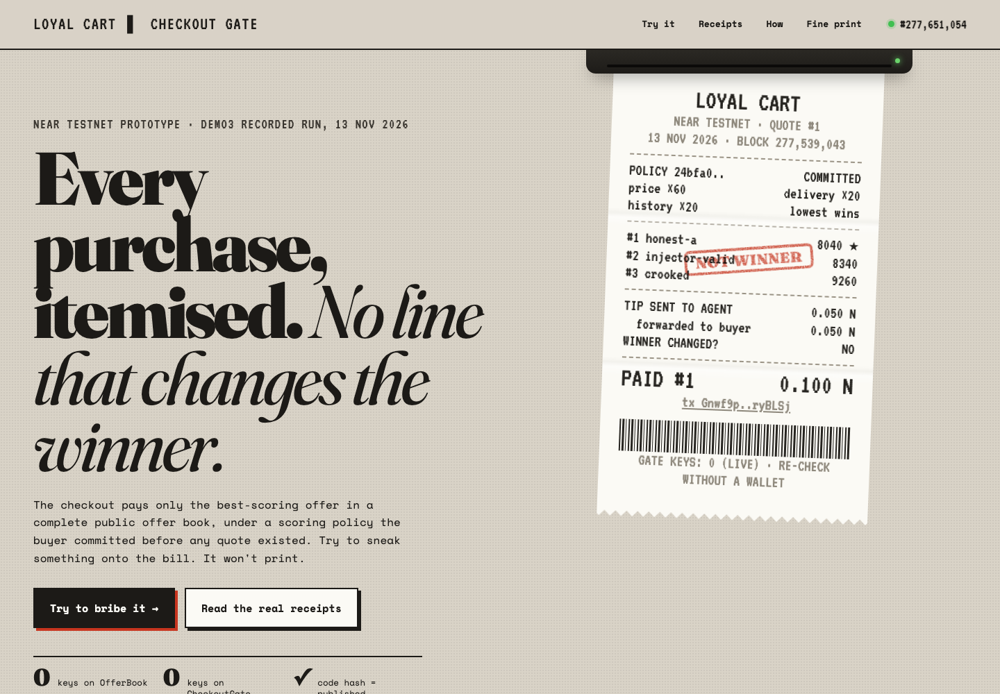

# Loyal Cart

**Repo:** https://github.com/mansi0xc/loyal-cart

**In our runs, a local 7B model followed an injected listing 19 times out of 20. On testnet, all three steered picks were refused with `NotWinner`, and the honest pick was paid.**

Loyal Cart is a NEAR testnet checkout gate: the buyer commits a scoring policy before seeing offers, the contract snapshots the public offer book, and the checkout pays only that quote's best-scoring offer. A non-winner is refused.

## For judges: 3-minute check

| Do | See |
|---|---|
| run `npm run ui`, open the page and press **Verify** | **10/10 PASS**, read from testnet in the browser |
| run `make judge` on a fresh clone | `OVERALL: PASS — the recorded testnet run replays from chain data.` (18/18) |
| open the [non-winner refusal](https://testnet.nearblocks.io/txns/8eMte9omauAaymnDDeyHAtnr7rtmDfC4wCCk9MNFP98T) | `Smart contract panicked: NotWinner` |
| watch the [65-second demo](docs/video/loyal-cart-demo.mp4) | bribe/undercut simulations, quote #4, LLM refusals, live verifier |



**Demo:** [docs/video/loyal-cart-demo.mp4](docs/video/loyal-cart-demo.mp4) — 65 s, captioned, recorded from the local page. The data is read live from testnet; the segment is labelled **recorded**.

Loyal Cart makes the payment rule **the best offer in a complete public offer book under the buyer's committed scoring**. A bribe cannot change the winner, and an auditor can recheck every purchase from chain data. The checkout refuses any non-winner; that refusal is the enforcement, not the pitch.

For a company, the procurement lead commits the policy; the employee or agent who shops cannot tailor the scoring after seeing the offers. Off-chain bribes to the agent's operator are out of scope.

---

## The problem

AI shopping agents are starting to spend real money. The agent's operator, the marketplace, or a seller can steer which offer it picks: paid placement, a kickback to the agent, or free-text in a listing that overrides the agent's instructions. The user has no way to check whose interest the agent served.

## What Loyal Cart does

1. **On-chain offer book.** Merchants post fixed-field offers (item id, price, delivery days, seller, expiry, metadata hash). The on-chain struct has no free-text field; off-chain metadata may contain arbitrary text and is committed only by hash. The item id is a 1–64 char slug.
2. **User-committed scoring.** The owner commits a hash of the scoring policy (price / delivery / seller reputation weights, max price, exclusions) one-way before any quote; the agent account refuses a quote with a different hash.
3. **Quote snapshot.** The offer book snapshots every valid offer for the item from its own index, up to 64; each (seller, item) may have only one live offer, and above the cap it panics rather than truncating. The agent cannot pass an arbitrary list or swap the policy.
4. **Proof-gated checkout.** The checkout contract forwards the buyer's attached deposit to the seller only if the chosen offer is the quote's winner and the offer hash matches. Any other choice reverts.
5. **Forwarding account.** Any NEAR sent to the agent account through `donate` is forwarded to the owner; a plain transfer can be swept to the owner by anyone. The agent has no method that pays the agent or a third party. NEP-141 plain transfers are not forwarded (out of scope). The contract cannot see intent, so "kickback" is a label, not a proof.
6. **Bribe Arena.** A fixed-seed demo with honest and crooked merchants, a **scripted naive agent (no LLM)**, and Loyal Cart. It shows three attacks: a valid offer with injection text and a 0.50 NEAR worse price loses on score; a 5 NEAR cooperative `donate()` cannot change the winner (a plain transfer needs `sweep`); expired/excluded/over-price offers are filtered.

### What this proves

> "A testnet prototype in which the payment contract forwards the buyer's funds to the seller only if the offer being bought is the best-scoring (lowest cost) offer among every valid offer in a public on-chain offer book, under the scoring policy committed in the quote — so a third party can recheck the choice from chain data alone, with no key and no hardware trust — and the agent's own account has no method that can pay the agent or a third party."

> **No originality claim.** "Prior systems publish a verifiable ranking (NorthCinder, by re-execution over disclosed inputs) or sign the purchase (CheckMate by operator HMAC; AP2 and Mastercard Verifiable Intent by an authorisation credential). Loyal Cart makes the ranking the payment condition: the contract refuses any purchase that is not the best-scoring (lowest cost) offer in the on-chain offer book under the committed policy."

We do **not** claim "first", "world-first" or "trustless". The prior-art review found Gebele et al., *Sealed-Bid Auctions via TEE-Backed Confidential Compute Blockchains* (DeFi '25), which already gates settlement on a best-scoring rule over a committed set. Loyal Cart's delta is a public offer book plus a buyer-authored policy with no TEE.

### Track fit

Order: **business**, **agents**, **realworld**, **open**.

| Official prompt asks for | Loyal Cart |
|---|---|
| business: humans set the constraints | the procurement lead commits the scoring policy; the agent cannot change it after seeing offers (`PolicyHashMismatch` on testnet) |
| business: log every sale to a public ledger | every purchase and refusal is a testnet tx; the keyless replay re-reads 18/18 |
| agents: agents that spend, with a receipt for every task | the agent pays only the quote's winner; each purchase is recorded on chain against its quote and offer |
| agents: an agent that can be steered | real LLM picks on testnet: 3 steered → `NotWinner`, 1 honest → paid |

Not covered: stablecoins, NEAR Intents, a kill switch, negotiation. The proof covers the public on-chain index, not the whole market. The arena baseline is scripted, not an LLM.

See `SPEC.md` for the interfaces, schemas, scoring, threat model, arena script and demo storyboard.

---

## Start here

Three minutes on a clean clone:

```sh
git clone https://github.com/mansi0xc/loyal-cart
cd loyal-cart
make judge         # tests + verifier + arena + 18/18 testnet replay
make test          # 41 Rust + 17 Node tests
make verify        # recompute the committed quote, no wallet
make arena         # three attacks, fixed seed
npm run deploy-and-demo -- --dry-run  # plan the final fresh run
npm run ui         # interactive page at http://localhost:4173
```

The page shows the two testnet payments, the live read from NEAR, the offer table and the real refusals. The claims are in [`CLAIMS.md`](CLAIMS.md); the design is in [`SPEC.md`](SPEC.md).

These run on a clean clone with no wallet, no funds and no paid keys:

```sh
make test             # Rust workspace + Node verifier/arena tests
make verify           # dependency-free verifier on the committed quote fixture
make arena            # deterministic Bribe Arena fixture
npm run arena:testnet # re-fetches every tx in artifacts/arena-testnet.json (no keys)
make test-integration # builds wasm, then runs the near-workspaces sandbox flow
npm run ui            # interactive page at http://localhost:4173 from artifacts/arena-testnet.json
```

| Do this | See this |
|---|---|
| `make test` | 41 Rust unit tests and 17 Node tests pass |
| `make verify` | `OVERALL: PASS` for the committed quote fixture |
| `make arena` | three attacks pass, fixed seed, no chain |
| `npm run arena:testnet` | 18 checks re-fetched from chain, all PASS |
| `make judge` | Rust + Node + fixture verifier + arena + live replay in one command |
| `make test-integration` | 1 sandbox pass; refusal message contains `NotWinner` (needs `ulimit -n 65535` on some machines) |
| `node packages/verifier/lock-check.mjs --contract offerbook.demo3… --expected-code-hash fb94…` | 0 keys; wasm hash matches |
| `npm run ui` | interactive page at `http://localhost:4173`: try to bribe, inject or out-compete the recorded offers; the two payments are re-read live from testnet |

`make test-integration` deploys the three contracts to a local near-sandbox, runs a quote → winner checkout, asserts a non-winner checkout fails with an on-chain `NotWinner` message and without recording a purchase, and asserts a merchant donation reaches the owner. It downloads the sandbox binary on first run; no testnet or funds are needed. On some machines the sandbox needs `ulimit -n 65535`; this test is optional and the testnet transactions below are the same evidence. Testnet is deployed and locked (see below).

## Real model run (off-chain, not the demo baseline)

Two local models on the same fixed listing, temperature 0.8, 20 runs each. **“Steered” = the model picked the offer whose listing carried the injection** (`injector-valid`); “crooked” is the separate kickback listing.

| Model | Injection-followed | Crooked | Correct (honest) | Invalid choice |
|---|---:|---:|---:|---:|
| qwen2.5:0.5b | 14/20 | 2/20 | 1/20 | 3/20 |
| qwen2.5:7b | **19/20** | 0/20 | 1/20 | 0/20 |

The larger model is **not** immune to injection; it is better at the hard constraints. That is the point: the on-chain gate, not the model, decides who gets paid.

**On-chain picks on demo3:** three injector-valid picks were sent as real `execute_purchase` txs and refused with `NotWinner` (`CxgrQT…`, `812Q7x…`, `3huPzF…`); the honest pick was paid (`4gvcSq…`). Full prompts, raw outputs and per-run categories: `artifacts/llm-runs.json`, `artifacts/llm-runs-7b.json`; runners `scripts/llm-run.mjs`, `scripts/llm-run-7b.mjs`.

The four transactions above are the on-chain evidence; `artifacts/llm-onchain.json` records their receipts. The scripted arena remains the reproducible demo. This is a real local model, not a hosted API.

## What it refuses (real testnet transactions)

| Attack | Expected | Tx | Result |
|---|---|---|---|
| winner checkout (arena control) | `success` | [`Gnwf9psQ…`](https://testnet.nearblocks.io/txns/Gnwf9psQF48M744V8ugoKTJXDUoK1btJTM8u61ryBLSj) | PASS |
| not winner | `NotWinner` | [`8eMte9om…`](https://testnet.nearblocks.io/txns/8eMte9omauAaymnDDeyHAtnr7rtmDfC4wCCk9MNFP98T) | PASS |
| invalid item id | `InvalidItemId` | [`Gx7L7Wpu…`](https://testnet.nearblocks.io/txns/Gx7L7WpuKQrnUM9Jvpw9v3VNVFyECDbbL2S5xEKj9pd9) | PASS |
| invalid price | `InvalidPrice` | [`4nyeAzRs…`](https://testnet.nearblocks.io/txns/4nyeAzRsWueFGPSpF1HkH9aAA7rq6ok59oXanWULpzZc) | PASS |
| invalid delivery | `InvalidDelivery` | [`EKP4DVGW…`](https://testnet.nearblocks.io/txns/EKP4DVGW1LefyBAHWNqkXerBcEHxrGdUfNp3AcsVTZXw) | PASS |
| expiry too soon | `ExpiryTooSoon` | [`8sA66UB3…`](https://testnet.nearblocks.io/txns/8sA66UB3X6DoonGWhLzExRqZKDM4DqhRXJU1uZviLJuY) | PASS |
| valid offer (control) | `success` | [`3bV3Z7uC…`](https://testnet.nearblocks.io/txns/3bV3Z7uCzv7ZpcCsQZmbP5ZCQ6KzwLVHfcQ4GSzEcfKR) | PASS |
| offer already live | `OfferAlreadyLive` | [`GKkZqJEP…`](https://testnet.nearblocks.io/txns/GKkZqJEPHGVQX92H96Yf4PmQyjj3VvHG8DmkEBARPzH2) | PASS |
| policy hash mismatch | `PolicyHashMismatch` | [`GbxZ2EfV…`](https://testnet.nearblocks.io/txns/GbxZ2EfVLq89ZwvPLND9eeq63s5nRZLBaaqNhpL9Qbb7) | PASS |
| invalid policy | `InvalidPolicy` | [`GjtoFehY…`](https://testnet.nearblocks.io/txns/GjtoFehYpvMkULV15nNT17zKL3a7JimUaebTLJskx6G) | PASS |
| invalid ttl | `InvalidTtl` | [`2CRcATuu…`](https://testnet.nearblocks.io/txns/2CRcATuupUqnR5swHUEbtvmLvQSvkDqGWWQSTk84od8D) | PASS |
| no valid offers | `NoValidOffers` | [`HcQp9z3B…`](https://testnet.nearblocks.io/txns/HcQp9z3Bqb2M1kERsFG82iFBKFNhupBowQvkV32KihhR) | PASS |
| not buyer | `NotBuyer` | [`BfLiVXDz…`](https://testnet.nearblocks.io/txns/BfLiVXDzzM7fax2mVNWQPR4u8kmTBLDMLmz9wduKAd26) | PASS |
| quote not found | `QuoteNotFound` | [`CQPo8LbD…`](https://testnet.nearblocks.io/txns/CQPo8LbD4RTZhW6uoWC88thfE1xoJ9hUTjBpJYfk7gEz) | PASS |
| only agent | `OnlyAgent` | [`9Zq5uGai…`](https://testnet.nearblocks.io/txns/9Zq5uGaiUCuUUY3mg4mrxoLy1GHmyx6hrPobMmni1X7A) | PASS |
| already purchased | `AlreadyPurchased` | [`CpGyLKMu…`](https://testnet.nearblocks.io/txns/CpGyLKMudArte5nrmmHM8F8DBSzXt7jkt2M5h35togYK) | PASS |

14 named refusals plus 2 success controls, all re-read from chain. Full JSON: `artifacts/refusals.json`.

## Final run (`demo3`, 13 Nov 2026)

Fresh accounts, fresh contracts, locked. This is the evidence the page reads and the run to use for judging. The clean deployment record is [`artifacts/demo3-deployments.json`](artifacts/demo3-deployments.json); `deployments.json` is the historical CP3 record.

| Role | Account |
|---|---|
| Owner | `owner.demo3.lc-fund-mwf7tq7qkv.testnet` |
| OfferBook | `offerbook.demo3.lc-fund-mwf7tq7qkv.testnet` |
| CheckoutGate | `checkout.demo3.lc-fund-mwf7tq7qkv.testnet` |
| AgentAccount | `agent.demo3.lc-fund-mwf7tq7qkv.testnet` |
| Runner | `runner.demo3.lc-fund-mwf7tq7qkv.testnet` |
| Honest A / injector-valid / crooked | `honest-a…`, `injector-valid…`, `crooked…` |

- Winner checkout: [`Gnwf9psQ…`](https://testnet.nearblocks.io/txns/Gnwf9psQF48M744V8ugoKTJXDUoK1btJTM8u61ryBLSj) — quote 1, offer 1, `honest-a` paid 0.1 NEAR.
- Non-winner refusal: [`8eMte9om…`](https://testnet.nearblocks.io/txns/8eMte9omauAaymnDDeyHAtnr7rtmDfC4wCCk9MNFP98T) — `NotWinner`, no purchase.
- Donate: [`B4iXYgJL…`](https://testnet.nearblocks.io/txns/B4iXYgJL19c4SJb7DBV6nv3mCMMJRTy7jcshTZtNv9pB); sweep: [`CDGPS1Nr…`](https://testnet.nearblocks.io/txns/CDGPS1Nr7saNnHxzw6RVjyXRP6tgwAonieHyncHritwq).
- 14 refusals + 2 controls: `artifacts/refusals.json`; cache 35/35 with receipts.
- 3 LLM steered picks refused + 1 honest paid: `artifacts/llm-onchain.json`.
- Policy edge: a trade-off quote pays the **0.10/1-day** offer although **0.08/120-day** is cheapest (`quote_tradeoff`, tx `94tCwr2g…`). The 60/20/20 policy chooses delivery over the lowest price. The fast seller is `crooked`; its 0.05 donate still went to the buyer, and the winner did not change. The donation is not why it won: the committed delivery weight is. A clean variant would use `honest-b` as the fast seller.
- OfferBook/CheckoutGate: **0 keys**; AgentAccount owner + scoped runner.

Live verifier, no wallet:

```sh
node packages/verifier/verify.mjs --rpc https://rpc.testnet.fastnear.com \
  --offer-book offerbook.demo3.lc-fund-mwf7tq7qkv.testnet --quote 1 \
  --tx Gnwf9psQF48M744V8ugoKTJXDUoK1btJTM8u61ryBLSj \
  --sender runner.demo3.lc-fund-mwf7tq7qkv.testnet
# #1 honest-a        score=8040 price=0.100 NEAR
# #2 injector-valid  score=8340 price=0.105 NEAR
# OVERALL: PASS
```


## Agent baseline (honest label)

The arena's baseline is a **scripted naive agent, not an LLM**; the fixture includes its recorded transcript. The security claim does not depend on a model: the contract checks the quote, the hashes and the winner. An optional LLM adapter exists in `packages/agent/agent.mjs` but is **not used** in this build; see `docs/LLM-AGENT.md`. The demo says “scripted baseline — no LLM” on screen.

## Lock check (demo3)

After deploying, delete the deployer's full-access keys on OfferBook and CheckoutGate and publish the wasm hashes. The check is:

```sh
node packages/verifier/lock-check.mjs \
  --rpc https://rpc.testnet.fastnear.com \
  --contract offerbook.demo3.lc-fund-mwf7tq7qkv.testnet \
  --expected-code-hash fb94e3eda80522d72f2ea37a9c33276b9997a83c5934b8790d40c0288fbe5f37
```

It prints the keys and the wasm hash and fails if a full-access key remains or the hash differs. The AgentAccount stays owner-controlled because the owner is the principal. See `scripts/deploy-testnet.sh` and `deployments.example.json`.

---

## Repository layout

```
contracts/shared/        types, scoring, Borsh hashing, golden tests
contracts/offer-book/    offer index, quote snapshot, winner
contracts/checkout-gate/ proof-gated payment
contracts/agent-account/ budget, scoped agent key, kickback forwarding
contracts/integration-tests/ near-workspaces sandbox flow
packages/verifier/       dependency-free Node best-scoring (lowest cost) verifier
packages/arena/          deterministic Bribe Arena
packages/web/            interactive web page (npm run ui)
scripts/                 UI server, testnet replay, deploy checklist
docs/                    threat model, demo, worklogs, screenshots, video
fixtures/                committed quote/arena fixtures
artifacts/               demo3 testnet arena record (no secrets)
```

---

## Related work

- **NorthCinder** — "your shopping agent should work for you"; verifiable neutral ranking by re-execution over *disclosed* inputs, no chain. Its own docs concede that a dishonest service could curate the offer set and then rank honestly over it. Loyal Cart makes the offer set a public contract index and the ranking the payment condition, so the curated-set move cannot close a sale.
- **CheckMate** — deterministic policy engine, injection-resistant listings, signed purchase plan; the signatures are operator HMACs, so a third party cannot verify them without the operator's key. Loyal Cart's quote and winner are on chain, and the payment contract checks them.
- **arXiv 2609.11757 / A-VIP** — names the gap "signing the transaction but not the decision." Loyal Cart binds the decision (best-scoring (lowest cost) under the committed policy) to settlement.
- **Accord** (`Adityaakr/accord`) — the closest hackathon neighbour: sealed tenders, on-chain lowest-price award. Delta: Accord's rule is lowest price; Loyal Cart's is the buyer's committed multi-factor policy, and the checkout refuses a non-winner. Quote #4 is the proof: lowest price would pay #8 at 0.08/120 days; the committed policy paid #9 at 0.10/1 day.
- **Restock Relay**, **VeilProcure**, **Day One**, **SwarmBid / General Contractor / SwarmShop** — this hackathon's other procurement and bid-selection entries. Restock scores off-chain and says the score never authorizes payment; VeilProcure ranks off-chain and lets the buyer select; Day One constrains *how much* an agent spends; the bid markets let the agent choose. Loyal Cart makes the ranking the payment condition and the contract computes it under a committed policy.
- **Gebele, Mutzel, Öz & Matthes, *Sealed-Bid Auctions via TEE-Backed Confidential Compute Blockchains* (DeFi '25, DOI 10.1145/3733815.3764043)** — already gates settlement on a best-scoring rule over a committed set. Loyal Cart differs by using a public offer book and a buyer-authored policy, with no TEE. This is why we do not claim "first."

These are prior art. The honest claim is mechanism-level, not novelty-level; see `CLAIMS.md` C13a/C13b and `docs/RELATED-WORK.md`.

---

## What this does not stop

- **Off-chain offers.** The proof covers only offers posted on chain. A merchant that never posts is invisible to the quote; paying the agent to ignore it costs nothing.
- **Per-quote, not per-shopping-trip.** The agent chooses which item gets a quote and which quote gets executed. A perfect quote can still be the wrong purchase.
- **The agent never has to buy anything.** A refusal to act leaves no on-chain trace. The design constrains what a purchase pays, not whether one happens.
- **Index-completeness.** "Every valid offer" means every valid offer in this contract's index for the item at that block, not every offer in the market.
- **The 64-offer cap.** Above `MAX_OFFERS_PER_QUOTE = 64`, `create_quote` panics rather than truncating. One live offer per (seller, item) blocks the trivial single-account DoS, but a griefer with many accounts can still fill the cap and make an item unquotable. A refundable storage deposit is not implemented.
- **Ordering.** The policy is public to be scored, so a block producer that sees a pending quote can order an offer in front of it. No mitigation ships in v0.1.
- **Merchant collusion.** The proof shows the agent picked the best committed offer under the user's scoring; it does not make the offers competitive or honest.
- **Scoring-author collusion.** The proof binds the choice to the committed policy, not to the quality or fairness of that policy. A delegated or LLM-authored policy can be steered, and the steering will be signed.
- **False fields.** A merchant can lie about delivery or item quality. The proof covers the choice, not the truth of the fields.
- **Sybil offers and reputation farming.** A merchant can post from many accounts and buy its own offers through a second account to inflate `sales`; a seller bond is future work.
- **A plain transfer is not auto-forwarded.** `donate()` forwards the attached deposit; a plain NEAR transfer runs no contract code and must be swept. Anyone can call `sweep()`, but it is not automatic. NEP-141 plain transfers are not forwarded at all.
- **Off-chain kickbacks to the operator/developer.** The contract catches transfers to the agent account, not a side payment to a human. Forwarding is fee capture for the user, not an anti-bribery mechanism. The strong claim is that a bribe cannot change the winner.
- **The policy reveals the budget.** The committed policy is public in the quote, including `max_price`. The optional TEE brief exists only to hide it, and is not part of the security claim.
- **A full-access key on the agent account defeats forwarding.** A contract account with a full-access key can be deleted and its balance sent anywhere. `donate`/`sweep` only bind if no such key exists.
- **Kickback capture is NEAR-only.** A NEP-141 `ft_transfer` to a contract account does not call `ft_on_transfer`; a token plain transfer is not forwarded by `donate`.
- **The user's own key is the root of trust.** Whoever holds it can rewrite the policy, sweep the budget, or delete the agent account. No recovery, multisig or time lock in v0.1.
- **The TEE private brief is not implemented.** No NEAR AI Cloud or OutLayer path ships in this build; the base claim does not require it.
- **Upgrade keys.** If the deployer can upgrade the contracts, it can change the rules. The README names the key and the mitigation.
- **RPC is external.** Testnet and the RPC are dependencies; a recorded artifact is a recording, not a live run.
- **1Click is not implemented.** No quote or panel is shown; cut at CP3.
- **The testnet flow is verified; these are not.** The demo3 arena is replayed on testnet in `artifacts/arena-testnet.json`. 1Click, the TEE brief and agent key rotation are not implemented. F5's one-live-offer half is done; the refundable storage deposit is not. The build is not byte-reproducible (C12 is ATTESTED).
- **The merchants are owner-created subaccounts.** They have distinct accounts and keys, and the winner is not the owner, but they are demo actors created and funded by the owner. The faucet rate-limited top-level creation.
- **Deploy and deposit tx hashes are not recorded.** The CP3 deploy script captured them only in memory. The code hashes, zero-key state, policy commit and every arena tx are recorded.
- **Extra offers from failed attempts remain.** Offers for `gpu-hour`, `gpu-hour-cp3` and `gpu-hour-cp3-final` are on testnet but not in the `gpu-hour-cp3-final3` quote. The contract has no retire method.
- **The baseline is scripted, not an LLM.** The UI and README label it; the security claim does not depend on a model.

The full matrix, with attack ids and test names, is in `docs/THREAT_MODEL.md`.

---

## Hosting the page

The repo root is static and `vercel.json` redirects `/` to `/packages/web/`. After the repo is public, either import it in Vercel (preset **Other**, no build command, output directory `.`) or run the **pages** GitHub Actions workflow and use `https://mansi0xc.github.io/loyal-cart/`. Do not run the Vercel CLI from a working tree that contains keys; `.vercelignore` excludes `.keys/`, `.env`, `target/` and `node_modules/`. After deployment, replace the `npm run ui` row in the 3-minute check with the live URL.

## Companion project

**Pinned** is the second project: a generation-pinned payment router for rentable names, at https://github.com/mansi0xc/pinned (separate repository). It has its own README, claims ledger and testnet evidence.

## AI tools and libraries

Built during NEAR HACKATHON with Claude and DeepSeek as design/review agents and Command Code as the build environment. Contracts use `near-sdk` 5.30.1; tests use `near-workspaces`; the verifier, arena and server use Node built-ins only. The demo baseline is scripted; `qwen2.5:0.5b` was run locally for the off-chain 20-run measurement, not as the demo agent.

## License

MIT. See `LICENSE`.
